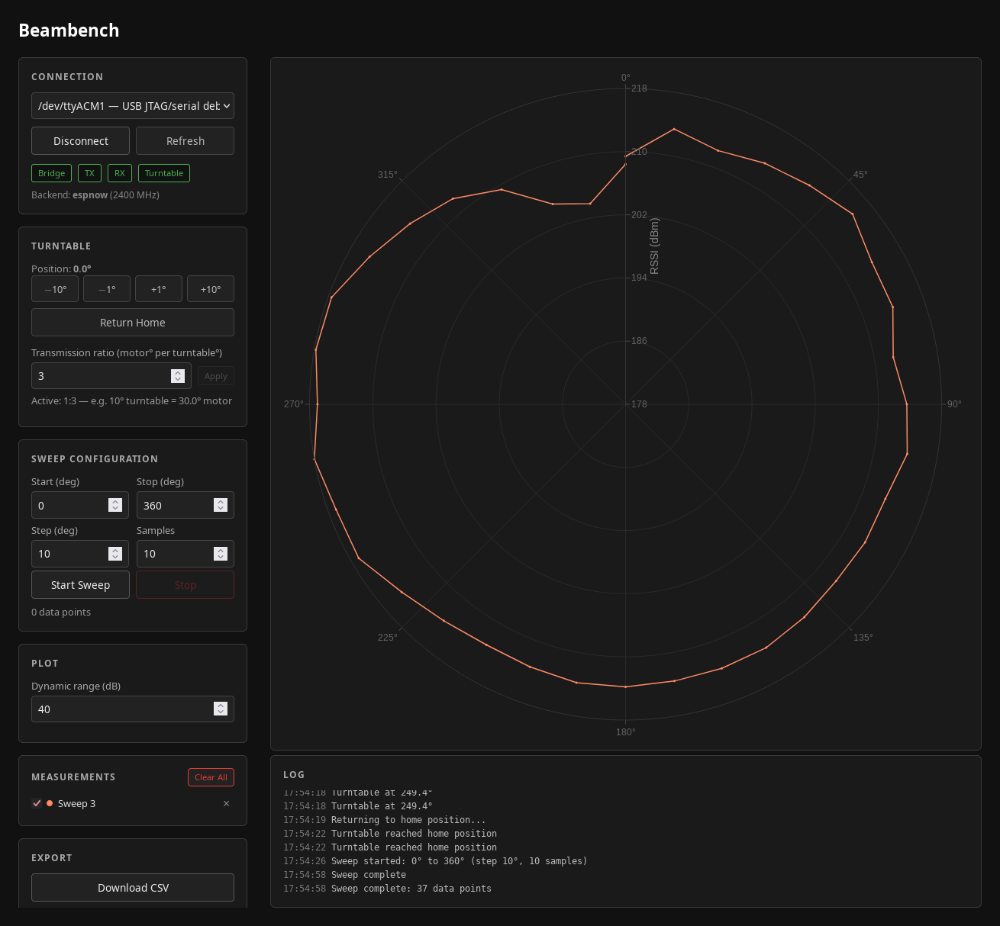

# Beambench

Antenna pattern measurement with four ESP32-C3 boards and a turntable.
Firmware, backend and protocol are written in Rust; the UI is Svelte.

> **Proof of concept.** Written with [Claude Code](https://claude.com/claude-code), not yet reviewed.



## Architecture

```
            PC: Axum backend + browser UI
                        │ USB-serial (COBS + postcard)
                  ESP32-C3: Bridge
                        │ ESP-NOW (postcard)
       ┌────────────────┼────────────────┐
  ESP32-C3: TX     ESP32-C3: RX     ESP32-C3: Turntable
  antenna under    measures RSSI    drives the
  test, rotates                     stepper motor
```

The turntable rotates the TX antenna. The RX measures the RSSI of TX beacons at each angle.

## Repository

| Path | Content |
|---|---|
| `software/protocol` | Shared `no_std` message types and routing logic |
| `software/firmware` | One firmware for all boards; role via Cargo feature |
| `software/pc` | Axum backend, Svelte frontend, bridge simulator |

## Protocol

- Every frame starts with `PROTOCOL_VERSION`. Frames of another version are not decoded, only reported.
- Golden-bytes tests in `protocol/src/golden.rs` pin the wire layout of every message.
- The bridge simulator runs the same `bridge_logic`, `tx_logic` and `rx_logic` as the firmware.

## Requirements

- Rust toolchain from `rust-toolchain.toml`, installed automatically by `rustup`
- [`just`](https://github.com/casey/just), [`pnpm`](https://pnpm.io)
- [`espflash`](https://github.com/esp-rs/espflash) for flashing, [`probe-rs`](https://probe.rs) for defmt logs

## Usage

Without hardware:

```sh
cd software/pc
just sim    # bridge simulator on 127.0.0.1:9876
just dev    # backend + UI on http://localhost:5173
```

Flash a board. This writes its role to flash once:

```sh
cd software/firmware
just flash-bridge    # or flash-tx, flash-rx, flash-turntable
just monitor         # defmt logs via probe-rs
```

Update paired boards over the air (PC app must be running):

```sh
just ota-tx          # or ota-rx, ota-turntable
```

## Development

```sh
just test      # protocol and PC tests
just clippy    # all crates, all roles, warnings are errors
just check
```

CI runs formatting, clippy, tests and the firmware build for all crates, plus lint, type check and build of the frontend.

## Hardware

- 4× ESP32-C3-DevKit-RUST-1
- MKS SERVO42D stepper driver (step/dir), 12–24 V supply

| ESP32-C3 | SERVO42D | Function |
|---|---|---|
| 3.3 V | COM | Common anode |
| GPIO7 | STP | Step |
| GPIO8 | DIR | Direction |
| GPIO6 | EN | Enable, active low |
| GND | GND | Ground |

3200 microsteps per revolution. Motor-to-turntable ratio is set in the UI (default 3).

## License

[MIT](LICENSE). © 2026 Systemscape GmbH.
